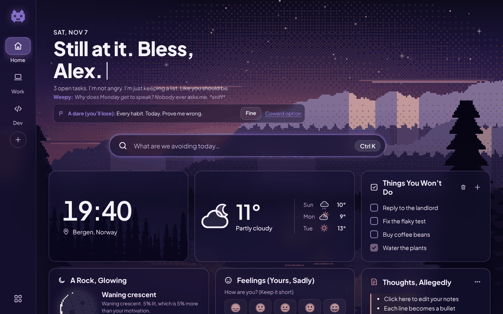
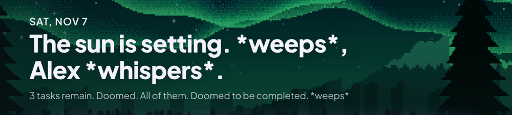
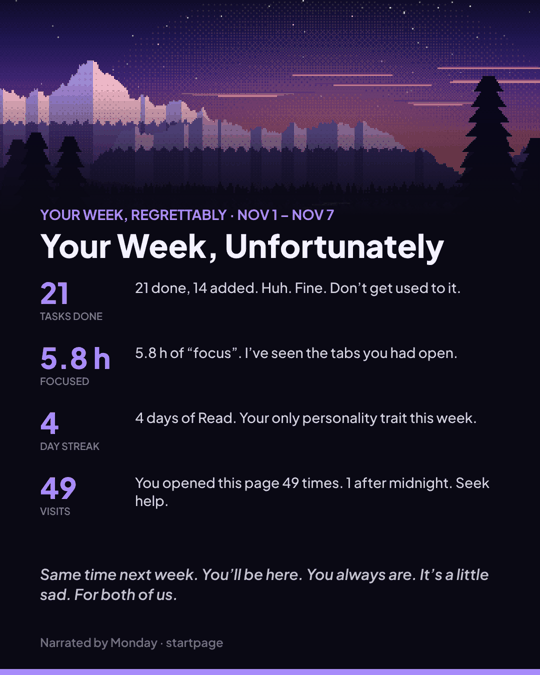
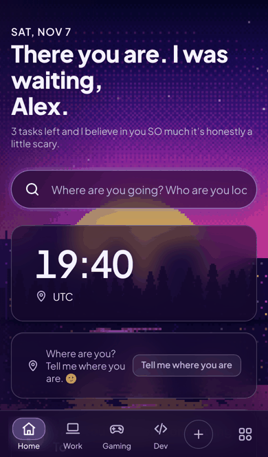

# Startpage

**A new tab page with opinions.**



Open a new tab and you get a pixel-art sky, your tasks, the weather, a moon that knows its phase, and someone who has thoughts about all of it.

> **Monday:** 3 open tasks. I’m not angry. I’m just keeping a list. Like you should be.

**Try it:** [start.vardir.no](https://start.vardir.no/). No account, no tracking; everything stays in your browser.

---

## Meet the voices

A voice doesn’t just change the greeting. It rewrites the whole page: widget titles, buttons, settings, error messages, even the dialog that asks whether you really want to delete everything. Pick one during setup, or under Customize → Voice. Every voice has opinions about the others, and they share them in the voice picker. If a voice renames a button beyond recognition, hover it for the plain wording; on a phone, it sits just underneath.

### Neutral · *just the facts*


Says what’s there and moves on. The control group, and the one to pick when the others get to be too much. Its entire reaction to you finishing every single task:
> “All tasks done.”

### Monday · *tired of you*


Dry, exhausted by your existence, and secretly the one who notices everything. Pause the focus timer early and:
> “24:59 left and you bailed. Riveting stamina.”

### Super Supportive · *never leaving*


Loves you. Counts your visits. Has your anniversary in the calendar, though you don’t. Delete a task without doing it and:
> “You deleted ‘Fix the flaky test’? Just like that? Is that what you’ll do to me? 🙂”

### Surfer · *forgot your name*


Extremely relaxed. Works out your name from its shape, then gives up halfway. Delete a task and:
> “Let it go, man. Like the ocean. The ocean doesn’t have a to-do list.”

### Professional · *building a case*


Treats your new tab like a performance review. Everything is noted, everything goes in your file.
> “‘Fix the flaky test’ descoped without delivery. Please send a written justification by EOD.”

### Therapist · *billing by the minute*


Gently curious about why you’re like this. Invoices in euros. Abandon a focus session and:
> “You abandoned the session. Does that remind you of anything? Your father, perhaps?”

### Weepy · *in mourning*


Every finished task is a little death, and every closed tab a goodbye. Tick something off and:
> “You ticked it. It’s gone. Everything goes eventually. \*stares into the rain\*”

### Victorian · *disapproving*


Your grandmother, in a browser. Has views on your tabs, your spelling and your posture. Open a tab at 2am and:
> “It is 02:14. Decent people are asleep. I am awake only to disapprove of you.”

### Brutal · *no mercy, no filter*


Monday is tired of you. Brutal thinks you’re wasting your life, and tells you so: cold, direct, your own numbers read back to you, and a grade on your weekly recap. It goes after your work, your habits and your excuses, never after who you are. Pause the focus timer early and:
> “Paused with 11:20 left. Of course you fucking did.”

Finish everything, though, and you get a rare, grudging nod: *“All of it. Fine. That’s what you’re capable of. Remember it next time you whine.”*

> **Heads-up: Brutal swears.** It’s tagged *Swears* in the voice picker and during setup. To keep the meanness but lose the language, switch off *Let Brutal swear* (Customize → Voice). The words are then masked (f\*\*\*, s\*\*\*), and read-aloud says “bleep”. No other voice swears.

### …and three you have to earn

They wait in the voice picker as `???`, each with a hint.

**Night Owl** · *open a tab after midnight on five different nights*


> “Sleep is a subscription you cancelled.”

**Ghost** · *stay away for a week*


> “oh. you’re alive.”

**Proud Parent** · *keep any habit going for 30 days*


> “THAT’S MY KID!!!”

### …or make your own

Customize → Voice → **Create a voice**. Describe a personality, say “a pirate who hates Mondays”, and Claude writes the whole voice: greetings, reactions, weather comments, the lot. Share it as a link. Your friends will hate it. (Needs your own Claude API key; see [Ask a voice](#ask-a-voice).)

---

## They’re paying attention

- **They react.** Tick a task, delete one you never did, pause the timer early, show up at 3am, or open the page for the twentieth time today, and you’ll hear about it. *“Deleting it doesn’t count as doing it. Nice try, though.”*
- **They hold grudges.** Leave Monday for Super Supportive twice, then come back: *“You left me for Super Supportive twice. I counted. Purely for the paperwork.”*
- **They grow on you.** At 7, 30 and 90 days with the same voice, it lets its guard down a little. *“30 days. …I’d miss you. Slightly. Don’t tell anyone.”* Ghost becomes less see-through the longer you stay.
- **They argue.** Every so often another voice butts in under the summary line. *“Weepy: Why does Monday get to speak? Nobody ever asks me. I have so much to say. Most of it is about loss.”*
- **Chaos mode** gives every card on the page its own voice. It’s exactly as calm as it sounds.
- **They fight about you.** One day a week, two voices argue under the greeting about your to-do list, your sleep, your streaks or your focus, using your real numbers. You vote. The winner gloats; if your voice loses, it sulks on the summary line for the rest of the day. *“I lost the face-off. Today’s summary is cancelled. Figure it out yourself.”*
- **They notice your bookmarks.** Open YouTube for the fifth time and Monday has thoughts: *“5 trips to youtube.com. “Just one video.” Sure.”* Counted only in your browser.
- **They drink on Fridays.** On Friday and Saturday nights (22:00 to 03:00), whichever voice you use has had a few. Its chatter slurs, hiccups and drifts into over-affectionate asides, while buttons and settings stay sober. Brutal admits it’s proud of you; Victorian insists it was one sherry; the cat walks a little unsteadily. If you were there, the next morning brings something sheepish: *“About last night. I said some nice things. They were lies. Mostly.”* Switch it off with *Friday night mode* in Customize → Voice.
- **They can speak.** Turn on *Read reactions aloud* and each voice gets its own pitch and pace: a slow Victorian, a breathless Supportive, a Ghost you can barely hear.

## Little rituals

- **Morning brief.** On the first tab of the day: the weather, what’s on your list, the streak you’ll lose if you skip today, and what’s coming up this week. In voice, of course.
- **Daily dares.** One small, optional dare a day. *“Finish one task before you open YouTube. I dare you.”* Say no and you just get a look: *“Saw that coming from a mile away. Two miles.”* No penalties, ever.
- **Wrapped.** On the first tab each Sunday, your week, narrated: tasks done, focus time, streaks, how often you opened this page (and how many of those visits were after midnight). Save it as an image to share.
- **Levels.** Tasks, focus sessions, dares and habits earn points, and every voice has its own titles. Professional promotes you from Intern to Chief Everything Officer; Victorian lets you up from the scullery; Monday goes from *Mild disappointment* to *Fine, you win*.
- **Time capsule.** Write a note to future you and seal it for a week, a month, three months or a year. No peeking. When it’s due, you break a wax seal and the voice of the day introduces it: *“8 days ago, you wrote this. Let’s see how that aged.”*
- **Your birthday.** Tell it the date (Customize → You) and on the day the greeting changes, balloons rise through the scene, the cat wears a party hat, and every voice leaves you a card. The one you’ve spent the most days with gets the big one. Secret voices you haven’t earned leave sealed cards.
- **Achievements.** Fourteen of them, three of which unlock new scenes (Dunes, Harbor, Polar Night).
- **Discoveries.** Twelve things are hidden on this page. We’re not listing them. (Fine, one: the Konami code works.)

<p align="center"></p>

## The cat

A small ginger pixel cat lives on top of your cards. It wanders, naps, sleeps at night, sits under an umbrella when it rains, looks up at fireworks, and runs over when you finish a task. Poke it and it answers; hover over it and it purrs. Pick how lively it is in Customize → Look: **Lazy** mostly naps, **Lively** plays and chases your pointer (and uses a little more CPU), or turn it off.

## The sky is real

The background is procedurally generated pixel art: mountains, cities, dunes, auroras, drawn fresh from a seed with no image files. Shuffle it as often as you like.

Give it your location and it follows the real world: rain when it’s raining outside, fog, snow, the occasional thunderstorm, and light that tracks your actual sunrise and sunset. The seasons show up too (blossoms, fireflies, falling leaves, flurries), flipped if you live south of the equator. A few holidays bring visitors:

| When | What happens |
|---|---|
| Oct 25–31 | **Haunted week.** Bats all week, and Ghost moves in, whether or not you’ve unlocked it. |
| Dec 20–26 | **Yuletide.** Fairy lights, and Victorian narrates your weekly recap. |
| Dec 31 | Fireworks. |
| Feb 14 | Hearts. Super Supportive will not stop talking. |
| Apr 1 | Chaos mode for everyone. Monday filed a complaint. |

## What’s on it

Widgets you can put on any space (Home, Work, Gaming, Dev, or your own), each with its own layout and card sizes:

| | |
|---|---|
| **Daily** | clock · weather · forecast (with air quality) · moon · on this day · daily quote |
| **Getting things done** | tasks · notes · focus timer · habits with streaks and a heatmap · countdowns · calendar with week numbers · days since |
| **For developers** | GitHub activity and CI · repo vitals (which of your repos are alive, fading or dead) · Hacker News / dev.to |
| **Everything else** | bookmarks and folders · music player (your own streams) · currency converter · mood check-in · time capsule · decide (see below) |

**Decide** is for when you can’t: a coin that actually flips (and very occasionally lands on its edge), a die that tumbles, a magic 8-ball that shakes, a slot reel that picks one of your options, rock-paper-scissors against your voice (beat it three times in a row and it starts peeking), and **would you rather**, where two voices each pitch you an option and react to whichever you choose.

Sounds are off by default. Turn them on in Customize → Voice for a clinking coin, clattering dice, a ticking reel and a small fanfare for achievements. They’re generated in the browser, so there are no audio files.

## The search bar is doing a lot

| Type | Get |
|---|---|
| anything | your search engine, with matching bookmarks suggested |
| `!gh` `!mdn` `!yt` `!w` `!npm` `!so` `!r` `!maps` | search that site directly |
| `12*7`, `sqrt(2)*12^2` | the answer (a real parser, no `eval`) |
| `5 km to mi`, `100 c to f`, `100 usd to eur` | conversions, including currency at today’s ECB rates |
| `days until 2027-07-01`, `week` | date maths |
| `>` | commands: `>task buy milk`, `>theme forest`, `>space dev`, `>wrapped`, `>brief`, `>chaos`… |
| `? anything` | ask the current voice (see below) |
| `hi monday` | try it |

**Keys:** `Ctrl/⌘ K` or `/` to search · `Alt 1…9` to switch space · `Esc` to close things. With Customize open, drag cards by their grip to rearrange them, and use the size button for small, medium or large.

## Ask a voice

Type `? remind me to call mum tomorrow and start a 25 minute timer`. The current voice answers in character, and actually does it: it adds the task and starts the timer, then complains about it. It can also tick off tasks, add notes, habits and countdowns, change the scene, and look up your week.

This uses the Claude API with **your own key** (Customize → Voice → Ask a voice). Claude Opus 5.5 is the default; Sonnet 5.5 and Haiku 5.5 are cheaper options. Requests go straight from your browser to Anthropic.

> **The trade-off, plainly:** the key is stored in this browser’s `localStorage`. It never syncs and is never exported, but anything that can run script on the page (including browser extensions) could read it. Use a key with a low spending limit.

## Get it



- **On the web:** [start.vardir.no](https://start.vardir.no/). Set it as your homepage.
- **On your phone:** open that link, then choose *Add to Home screen*. It installs like an app, opens full-screen and works offline.
- **As your new tab (Chrome, Edge, Brave):** download the latest zip from [Releases](https://github.com/vardirhq/startpage/releases), or clone this repo. Then go to `chrome://extensions`, turn on *Developer mode*, click *Load unpacked* and pick the folder.
- **Firefox:** use the `-firefox.zip` from Releases, via *about:debugging → Load Temporary Add-on*.
- **Across devices:** add a GitHub token with `gist` access (Customize → Data → Sync) and your setup follows you through a private gist. The token itself is never uploaded.

A fresh install starts empty: no name, no location, just a short setup, which you can skip, and a few example tasks that explain themselves.

<br clear="right">

## Your data

Everything lives in your browser: no server, no analytics, no account. The page only talks to the services you switch on (weather, GitHub, news, Wikipedia, exchange rates, and Claude if you add a key), straight from your browser. The details are in [PRIVACY.md](PRIVACY.md).

## Honest limitations

- A web page can’t see what Spotify or any other app is playing, so the music widget plays your own streams and files.
- In an extension’s new tab, Chrome puts the cursor in the address bar first. Press `/` to jump to the page’s own search.
- The moon’s dates are right to within a day: it’s maths, not NASA.
- Grudges, bonds and visit counts are kept per device, so your phone’s Monday doesn’t know what your laptop’s Monday knows.

---

## For developers

Plain HTML, CSS and JavaScript. **No build step, no dependencies, no framework.** Open `index.html` and it runs. The same files are the website, the installable app and the browser extension.

```
npx serve .                      # or just open index.html
node --test test/*.test.js       # unit tests
scripts/package.sh               # tests + Chrome and Firefox zips in dist/
```

<details>
<summary><b>Where things live</b></summary>

| File | What it does |
|---|---|
| `js/store.js` | State in `localStorage`, defaults, migrations, a TTL cache, IndexedDB for a custom background |
| `js/scene.js`, `js/anim.js` | The procedural pixel scenes (384×216, dithered) and the animation layer on top (~12 fps, pauses when hidden, off with reduced motion) |
| `js/sky.js`, `js/season.js` | Real weather and daylight in the scene; seasons and holiday events |
| `js/voices.js`, `js/brutal.js` | The nine regular voices. Neutral is the complete baseline; every other voice overrides it |
| `js/react.js`, `js/bonds.js`, `js/secrets.js` | Reactions, heckles, the activity log; grudges and bond levels; the three secret voices |
| `js/pet.js`, `js/sound.js` | The cat (a 20×17 sprite on a timer, not every frame); synthesised sound effects (Web Audio) |
| `js/capsule.js`, `js/birthday.js`, `js/faceoff.js`, `js/levels.js`, `js/roasts.js` | Time capsules, birthday mode, weekly face-offs, levels and titles, bookmark roasts |
| `js/tipsy.js` | Friday night mode: a deterministic slur applied to the chattier lines of any voice (so new content gets drunk for free) |
| `js/lines.js` | Fills every voice’s gaps, and adds variations to the lines you see most (page copy rotates hourly; toasts pick fresh each time) |
| `js/widgets.js`, `js/modules.js`, `js/modules2.js` | Every card on the page |
| `js/palette.js` | The search bar’s maths parser, unit, currency and date conversions, and `>` commands |
| `js/panel.js` | Customize: six tabs (Space, Look, Voice, You, Progress, Data), plus a search across all of them |
| `js/onboarding.js`, `js/brief.js`, `js/dares.js`, `js/wrapped.js`, `js/achieve.js`, `js/eggs.js` | Setup, the morning brief, dares, the weekly recap, achievements, discoveries |
| `js/ask.js`, `js/maker.js` | Claude: Ask (with tools) and the voice maker (structured output, sanitised share links) |
| `js/speak.js`, `js/sync.js` | Read-aloud; gist sync |
| `sw.js`, `app.webmanifest` | The installable app (stale-while-revalidate cache of the app shell; API calls always go to the network) |
| `manifest.json` | The browser extension (Manifest V3, no permissions) |

</details>

<details>
<summary><b>Tests</b></summary>

`node --test test/*.test.js` checks:
- **The voices:** it renders every line of every voice against rich data and against empty data, and fails on any `undefined`, `NaN` or `[object …]`.
- **Vocabulary:** Monday’s “ugh”, Surfer’s “man” and Weepy’s \*sob\* are capped.
- **Coverage and variety:** every voice has its own line for every key, and at least three variations of the lines you see most.
- **The maths parser and conversions:** including currency.
- **Voice behaviour:** secret-voice locking, grudges, bond levels and dares.
- **The calendar:** seasons, holiday events and moon phases.
- **The voice maker:** sanitising of imported voices.
- **Wiring:** that every file in `js/` is actually loaded.

The Pages workflow runs these before every deploy.

</details>

<details>
<summary><b>Releasing</b></summary>

1. Bump `version` in `manifest.json`.
2. After merging, publish a GitHub release with a matching tag (`v1.3.0`), or push the tag.
3. `.github/workflows/extension.yml` builds the Chrome and Firefox zips and attaches them to the release.

Uploading to the Chrome Web Store and to addons.mozilla.org is manual. The listing copy is in `store/listing.md`, the store images are in `store/`, and the privacy policy is `PRIVACY.md`.

Every push to `main` deploys the site to GitHub Pages via `.github/workflows/pages.yml`, served at [start.vardir.no](https://start.vardir.no/) (custom domain set in the repo’s Pages settings).

</details>

## Credits

The idea of personality voices comes from [Dead Repo](https://github.com/MadsenDev/dead-repo), and so does the alive / fading / flatlined / dead verdict in *Repo vitals*. Weather comes from [Open-Meteo](https://open-meteo.com), history from [Wikipedia](https://www.wikipedia.org), exchange rates from [Frankfurter](https://frankfurter.dev) (European Central Bank), and the type is [Plus Jakarta Sans](https://fonts.google.com/specimen/Plus+Jakarta+Sans).

---

<p align="center"><i>You read the whole README. Impressive. Now close it and go do one of those tasks.</i><br>— Monday</p>
